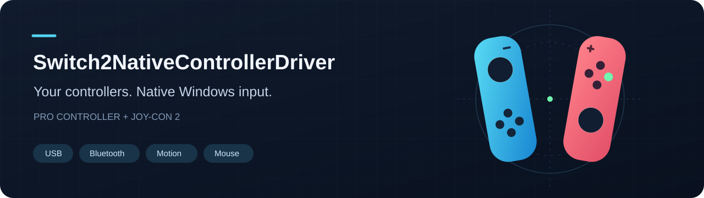
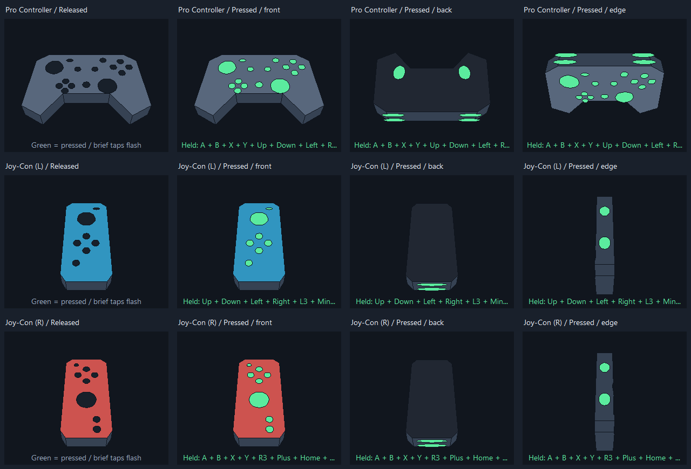
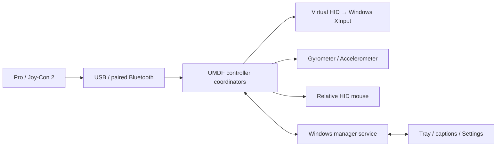

<div align="center">



# Switch2NativeControllerDriver

**Nintendo Switch 2 controllers, at home on Windows 11.**

Native gamepad input · Motion sensors · Optical & gyro mouse · Per-controller settings

[](https://github.com/SmokeyMcGames/Switch2NativeControllerDriver/actions/workflows/windows.yml)
[](LICENSE)


[Getting started](docs/INSTALLATION.md) · [Settings guide](SETTINGS.md) · [Controls](docs/CONTROLS.md) · [Report a bug](https://github.com/SmokeyMcGames/Switch2NativeControllerDriver/issues/new/choose)

</div>

Switch2NativeControllerDriver is an independent, open-source Windows driver and tray application for the **Nintendo Switch 2 Pro Controller and Joy-Con 2**. It exposes gamepads through Windows XInput, motion through native Windows sensor APIs, and Joy-Con mouse input through standard HID mouse reports.

**Development preview: 0.3.9.3.** The offline setup bundles the driver, tray, manager, uninstall support and exact corresponding source. End users do not need Visual Studio or the Windows Driver Kit. See [Downloads](https://github.com/SmokeyMcGames/Switch2NativeControllerDriver/releases) and the [installation and signing notes](docs/INSTALLATION.md).

This project has been tested on a limited set of hardware. The preview uses explicit development-certificate trust; it is **not a Microsoft-certified or Nintendo-endorsed production driver**. Windows policy may block installation. Production signing and broader clean-PC testing remain release requirements.

## What it does

| Feature | What you get |
| :--- | :--- |
| **Pro Controller over USB & Bluetooth** | Automatic transport selection, gamepad input, rumble, motion sensors and ordinary assignable Home input. |
| **Joy-Con 2 over Bluetooth** | Use one sideways, keep controllers separate, or combine opposite halves into one gamepad. |
| **Player LEDs** | Connection-order numbering for up to four Joy-Cons. Separate sideways LEDs read left to right. |
| **Native motion** | Gyroscope and accelerometer devices available through Windows sensor APIs. |
| **Optical mouse** | Move a Joy-Con across a surface to move the pointer. Lift it to return those controls to the gamepad. |
| **Gyro air mouse** | Aim with wrist rotation, pause with stick-click, and use your regular mouse without cursor snap-back. Works across displays. |
| **Click stabilization** | A brief gyro movement hold makes clicking easier; deliberate held movement breaks out early for dragging. |
| **Individual profiles** | Saved dead zones and gyro response follow each physical controller, including the Pro across USB/Bluetooth. |
| **Live diagnostics** | Stick plots, dead-zone overlays, motion readings and rotating 3D models with green button highlights. |
| **Connection-aware tray** | Custom icon, visible-tray toggle, fading captions and Settings. The tray exits after the last disconnect. |
| **Windows-owned pairing** | Pair/remove controllers in Windows Settings. The manager only uses devices registered as paired in Windows. |

### Controller support

| Controller | USB | Bluetooth | Gamepad | Native gyro / acceleration | Mouse |
| :--- | :---: | :---: | :---: | :---: | :--- |
| Switch 2 Pro Controller | Yes | Yes | Yes | Yes | — |
| Joy-Con 2 (L) | Not implemented | Yes | Sideways or combined | Yes | Fallback when no right Joy-Con is connected |
| Joy-Con 2 (R) | Not implemented | Yes | Sideways or combined | Yes | Preferred optical / gyro mouse |

The driver manages **one Pro Controller and up to four Joy-Cons**. Windows XInput allows four gamepads total: four separate Joy-Cons temporarily displace the Pro virtual gamepad while its physical connection stays available. Four simultaneous physical Joy-Con links have not been hardware-validated; testing covers one Pro and one left/right pair.

First-generation Switch controllers, charging grips and other controller models are outside this support table.

## Connect and play

1. Run the [development preview setup](docs/INSTALLATION.md), review its certificate notice, and select Install. Source builds remain available.
2. For Bluetooth, hold SYNC and select the controller in **Windows Settings → Bluetooth & devices → Add device → Bluetooth**.
3. If it appears as paired but immediately says **Not connected**, press a normal button once. This first-pairing behavior is a known limitation.
4. The player LED settles and the tray appears when connected. A Pro can also connect directly by USB.
5. Right-click **Switch2NativeControllerDriver** in the tray for **Settings...**, Joy-Con grouping and mouse modes.

The Joy-Con popup offers **Use both Joy-Cons as one controller?** and **Use both Joy-Cons separately?** Change the choice later from the tray. A lone Joy-Con uses a sideways layout with **SL/SR as shoulders**. Joy-Con player numbering is independent of the Pro. Removing a device in Windows removes it from the manager's paired roster.

## See what your controller is doing

Settings shows every active physical controller, including both halves of a combined pair.

- **Stick plots:** calibrated raw position, filtered output and a live dead-zone overlay.
- **Dead zones:** 8% Circular by default; optional Axis mode; independent settings for each stick.
- **Gyro response:** 10–360 mouse counts per degree, default 90, saved per Joy-Con.
- **Motion diagnostics:** angular velocity, acceleration, relative orientation, delivered rate and sample count.
- **3D models:** rotate with the controller; buttons glow green while pressed and brief taps flash. Includes stick clicks, shoulders, triggers, Joy-Con SL/SR and Pro GL/GR.
- **Reset and recenter:** reset only that controller's profile, or recenter only its preview heading.



<sub>Off-screen output from the actual model renderer with diagnostic pressed states; this illustrates the models, not the complete Settings window.</sub>

Profiles use factory identity rather than player number. The preview estimates **rotation**, not room position; yaw can drift without an absolute heading reference. [Settings guide](SETTINGS.md).

## Two ways to use a Joy-Con as a mouse

**Optical Mouse** uses the surface sensor. **Gyro Mouse** uses angular movement as a relative air mouse. The right Joy-Con takes priority; the left takes over when the right is absent. A connected left stays a normal gamepad while the right owns mouse input.

| Action | Right Joy-Con | Left Joy-Con acting as mouse |
| :--- | :--- | :--- |
| Left click | R | L |
| Right click | ZR | ZL |
| Middle click | X | Up-arrow |
| Scroll | Stick up/down | Stick up/down |
| Enable / disable Mouse Mode | Hold Plus, tap Home | Hold Minus, tap Capture |
| Switch optical / gyro | Hold Plus, click stick | Hold Minus, click stick |
| Pause / resume gyro movement | Stick-click alone | Stick-click alone |
| Raise optical sensitivity | Home | — |
| Lower optical sensitivity | C | Capture |

Active mouse actions are suppressed from the gamepad. Optical sensitivity ranges from 25% to 400%; gyro response has its own per-controller Settings control. Gyro pause stops movement while keeping clicks/scrolling available. Home remains an ordinary controller button outside relevant actions and does not launch Game Bar through this driver. [Control details](docs/CONTROLS.md).

## Motion rates, without inflated promises

Current stream configurations target roughly **200 distinct motion samples/s over Bluetooth** and **250/s over Pro USB**. Wireless rates depend on the adapter, simultaneous links and conditions. Recent three-controller Bluetooth spot checks ranged approximately **162–200 Hz**, including earlier near-200 Hz runs. These observations are not fixed guarantees.

**250 Hz Bluetooth and 500 Hz USB are not verified features.** Samples are not repeated or interpolated to inflate rates. XInput has no gyro channel: games need native sensor support or another integration. Settings renders around 25 frames/s while the driver processes motion separately.

[Validation and known limits](docs/VALIDATION.md).

## Build from source

Requirements: **Windows 11 x64**, Visual Studio 2022 C++ tools, CMake 3.24+, Windows SDK/WDK **10.0.26100.0**, and UMDF **2.31** libraries.

```powershell
git clone https://github.com/SmokeyMcGames/Switch2NativeControllerDriver.git
cd Switch2NativeControllerDriver
.\tools\Build.ps1
```

Build runs seven CTest suites and validates both INFs. It does **not** install a driver or change certificate trust. [Windows CI](.github/workflows/windows.yml) performs the same checks; CI is not hardware validation.

Signing, installation, updates, uninstall and recovery are covered in [INSTALLATION.md](docs/INSTALLATION.md). This source release has no production-signed installer.

## How it fits together



Uses Windows' existing UMDF/HID/XInput components. No bundled ViGEmBus, third-party controller bridge, Nintendo firmware or custom kernel-mode driver. The service remains available when no controllers are connected; the desktop tray does not.

[Developer guide](docs/DEVELOPMENT.md) · [Security](SECURITY.md) · [Privacy](PRIVACY.md)

## Current limits

- Experimental development signing; **not WHQL-certified or distributed through Windows Update**.
- One Pro Controller; Joy-Con transport is Bluetooth only.
- First Windows pairing may require one additional button press.
- XInput has four slots and no arbitrary extra-button or gyro channel. HID exposure/model diagnostics do not create new XInput buttons.
- Battery/charging telemetry, headset audio, NFC and console functions are not implemented or validated.
- Other controller software can contend for physical access or produce duplicate input.
- Updates can require a Windows restart when handles or pending replacements prevent unloading. Ordinary disconnects clear held input.
- More adapters, sleep/resume, long sessions, every game and anti-cheat compatibility remain open validation work.

## Contribute

Reproducible hardware reports, documentation and focused patches are welcome. Read [CONTRIBUTING.md](CONTRIBUTING.md), the [Code of Conduct](CODE_OF_CONDUCT.md), and [security reporting guidance](SECURITY.md). Redact hardware identities and personal paths from logs.

## License and acknowledgements

**GNU GPL version 3**; see [LICENSE](LICENSE), [COPYRIGHT.md](COPYRIGHT.md) and [third-party notices](THIRD_PARTY_NOTICES.md). Modified WinStadia-derived driver portions and SDL-derived motion/rumble work retain upstream attribution. Protocol research and licensing scope are documented in [PROVENANCE.md](docs/PROVENANCE.md).

Nintendo, Nintendo Switch, Joy-Con, Xbox and Windows are trademarks of their respective owners. Names identify compatibility. **This independent project is not affiliated with or endorsed by Nintendo or Microsoft.** The software license does not grant their trademark rights or guarantee patent clearance.
